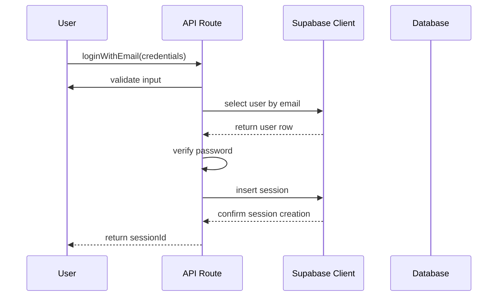

# Dev-Log Entry

## Source

- **File:** `examples/simple-login/loginRoute.ts`

## Tech stack (import specifiers)

- `@supabase/supabase-js`
- `bcrypt`
- `zod`

## Technical trade-offs

### Supabase vs. Firebase
The developer likely chose Supabase over Firebase for this file due to Supabase's direct integration with PostgreSQL, which is leveraged here for user authentication. This allows for complex queries and relationships that are more naturally expressed in SQL. Additionally, Supabase provides a more open-source approach, which may align better with the developer's preference for transparency and self-hosting capabilities compared to Firebase's proprietary nature.

### bcrypt vs. Argon2
The choice of bcrypt for password hashing instead of Argon2 could stem from bcrypt's long-standing reputation and widespread adoption in the industry. While Argon2 is considered more secure and resistant to certain attacks, bcrypt's performance and compatibility with existing systems may have made it a more practical choice for this specific implementation, especially given the simplicity of the demo context.

### zod vs. Joi
The use of zod for input validation instead of Joi may reflect a preference for TypeScript-first libraries. Zod's design allows for seamless integration with TypeScript's type system, providing compile-time type safety and reducing runtime errors. This can be particularly beneficial in a TypeScript environment, whereas Joi, while powerful, may require additional type definitions to achieve similar safety.

### Unknown Technologies
No other specific technologies are indicated in this file, so any further comparisons or trade-offs cannot be inferred.

## Data flow

